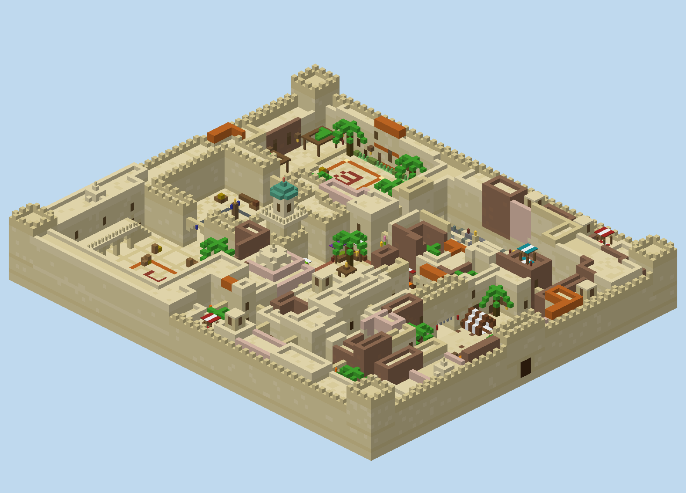

# Sunbaked Bazaar (NeoForge 1.20.1)

Одна команда будує посеред світу пустельну арену для двох команд — «Розпечений базар»: обнесене муром містечко
104×88 блоків з двома точками, трьома шляхами між ними та жартівливими табличками.



*Це схема, намальована з генератора карти, а не знімок із гри.*

## Команди

Потрібні права оператора (рівень 2).

| Команда | Що робить |
|---|---|
| `/bazaar build` | Будує арену одразу на схід від тебе; земля під ногами стає рівнем вулиць. |
| `/bazaar undo` | Прибирає арену й повертає місцевість, яка була до неї (працює й після перезапуску світу). |
| `/bazaar tp <місце>` | Телепортує: `attack`, `defend`, `a`, `b`, `plaza`. |

Найкраще будувати на рівному порожньому місці. Арена займає 6 блоків униз від рівня вулиць, а все, що було
вище в межах її контуру (пагорби, дерева), розчищається до неба. Усе це запам'ятовується і після `/bazaar undo`
повертається блок у блок, разом із вмістом скринь. В одному вимірі — одна арена.

## Що на карті

- **Караванний двір** (захід) — старт атаки: намети, вогнище, парковка верблюдів.
- **Форт** (схід) — старт оборони, звідки короткі проходи ведуть на обидві точки.
- **Точка А — караван-сарай** (північний схід): двір з галереями, на дах яких ведуть сходи.
- **Точка Б — пальмовий двір** (південний схід): басейн із фонтаном, тераса з перголами.
- **Північна вулиця** з арками — довгий шлях до А.
- **Ринкова вулиця** із зигзагом, що виходить на **площу з колодязем** і мінаретом; з площі провулки ведуть
  і до А, і до Б, і прямо до форту.
- **Східчастий колодязь** на півдні — заглиблений двір з водою, з якого до Б піднімаються сходи й низький тунель.

Планування власне, не скопійоване з жодної гри.

## Для розробки

Генератор карти (`src/main/java/com/reya/sandbazaar/map`) не залежить від Minecraft, тож карту можна намалювати
й перевірити без гри:

```
javac -d out src/main/java/com/reya/sandbazaar/map/*.java tools/Preview.java
java -cp out Preview out
```

Це малює `top.png`, `iso_se.png`, `iso_nw.png` і `reach.png` та проходить карту «ногами»: до всіх точок телепорту
можна дійти, ніде не можна застрягти чи вилізти на дахи. `./gradlew runGameTestServer` будує арену в тестовому
світі двічі — у небі й на справжній місцевості, — звіряє кожен блок і перевіряє, що після прибирання все як було.
